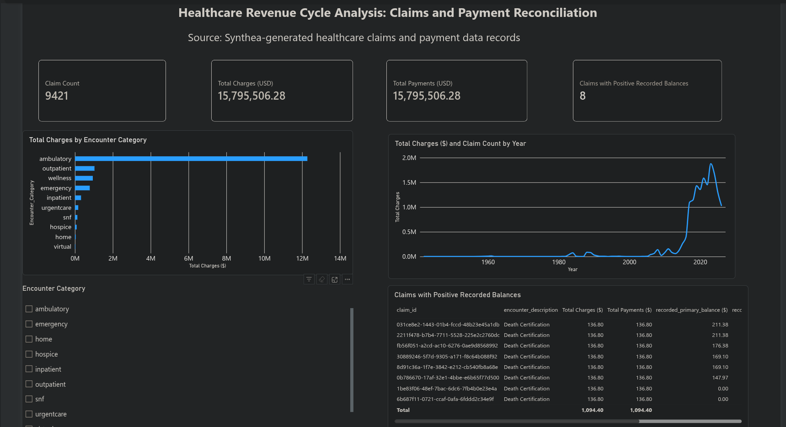
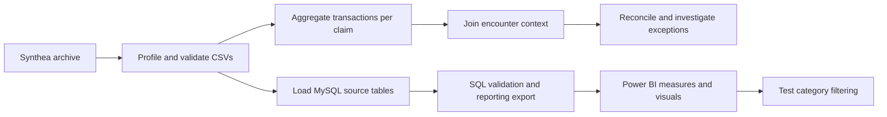

# Healthcare Claims and Payment Reconciliation

**Python · SQL/MySQL · Power BI · Data quality · Financial reconciliation**

Can matching charges and payments hide inconsistent reporting? This project
analyzes synthetic healthcare claims, checks the relationships behind financial
totals, and investigates eight records whose recorded balances disagree with
the exported transaction evidence.

The main finding: **eight death-certification encounters each include $74.58 in
encounter costs absent from exported charge transactions ($596.64 combined)**.
Reviewed Synthea source code supports a report-cost/export explanation. Matching
exported charges and payments does not establish complete encounter-cost coverage
or verified unpaid debt. The archive's exact generator version is unverified.

[](powerbi/screenshots/slicer-demo.mp4)

[Watch the category-filter demonstration (MP4, 39 seconds)](powerbi/screenshots/slicer-demo.mp4).
Select the screenshot or the link above to open the recording. It shows
ambulatory and other category selections, then clears the
selection to restore the full totals and eight exception rows.

## Results at a glance

| Measure | Verified result |
|---|---:|
| Synthetic patients | 108 |
| Encounters | 5,571 |
| Claims | 9,421 |
| Transaction records | 85,047 |
| Exported charges | $15,795,506.28 |
| Exported payments | $15,795,506.28 |
| Claims with transaction differences above $0.005 | 0 |
| Claims with positive recorded balances | 8 |
| Cost absent from charge export in investigated encounters | $596.64 |
| Ambulatory share of exported charges | 77.72% |

These describe this synthetic sample, not an actual provider's performance.
The $596.64 is a representation gap, not demonstrated revenue loss or money recovered.

## Review the work

- **[Three-page visual report (PDF)](docs/PROJECT_BRIEF.pdf):** project, work completed,
  results, impact, and recommendations.
- **[Reproduction guide](docs/REPRODUCIBILITY.md):** data provenance, environment,
  commands, database setup, and verification scope.
- **[Validation evidence](outputs/verification_summary.json):** 17 independently
  recomputed checks against archived CSVs and saved exports.
- **[Verifier failure checks](outputs/verifier_negative_controls.json):** deliberate
  changes to a copied balance flag and charge amount were both rejected.
- **[Eight exception traces](outputs/balance_exception_trace.csv):** exact-decimal
  comparison of encounter costs, transaction totals, and recorded balances.
- **[Category results](data/processed/financial_summary_by_category.csv)** and
  **[reporting data](outputs/claim_reporting.csv)**.
- **[Power BI measures and interaction checks](powerbi/README.md)**.

The overview screenshot and filter recording are included in this repository.
The visual project report PDF is included. A separate Power BI dashboard PDF
and editable model export are not included.

## Workflow



Transactions are aggregated before joining, preventing a one-to-many join from
multiplying financial totals. Left joins preserve source claims. Join checks
verify cardinality, row counts, encounter matches, and patient consistency.

## Run the analysis

Follow the [source restoration instructions](docs/REPRODUCIBILITY.md) first.
Run from the repository root:

```bash
python3 -m venv .venv
source .venv/bin/activate
python -m pip install -r requirements.txt
python scripts/profile_sources.py
python scripts/validate_financial_data.py
python scripts/analyze_financials.py
python scripts/reconcile_claim_balances.py
python scripts/trace_balance_exceptions.py
python scripts/verify_portfolio.py
```

`verify_portfolio.py` uses only Python's standard library and can verify the
preserved sample and saved exports without MySQL, Power BI, or an LLM. A new
installation is not claimed as tested; the [environment snapshot](docs/environment_snapshot.txt)
records the environment used for verification. MySQL is an optional reproduction
path and requires separate setup.

## Skills demonstrated

- Python/pandas source profiling, validation, aggregation, and reusable functions.
- SQL joins, CTEs, conditional aggregation, window functions, and reporting queries.
- SQLAlchemy database loading, transactions, schema checks, and decimal money types.
- Claim-level financial reconciliation and source-code-supported investigation.
- Power BI Service authoring, explicit DAX measures, cards, bar/line charts,
  a slicer, visual-level exception filtering, and tested filter interactions.
- Clear distinction between observed facts, supported explanations, and unverified claims.

The current Power BI model is one reporting table. Star-schema relationships,
RLS, scheduled refresh, drillthrough, and automated deployment
are not demonstrated capabilities.

## Scope and provenance

The original learning plan considered denials, appeals, patient journeys, and
revenue leakage. The delivered analysis is deliberately limited to claims,
payments, category activity, and reporting discrepancies; no denial dataset or
revenue-recovery result is implemented.

Data comes from [Synthea sample data](https://github.com/synthetichealth/synthea-sample-data),
generated by the [Synthea simulator](https://github.com/synthetichealth/synthea).
The original archive and extracted source files are retained locally and excluded
from Git; their hashes and dimensions are recorded in validation evidence.
The mutable upstream `latest` download may change. See the reproduction guide
for exact-snapshot limitations and source attribution.

This was a guided learning project using ChatGPT/Codex for explanation, code
review, and documentation assistance. Code, source references, and validation
results are available for review. The personal chat transcript is excluded.

Maintained by the repository owner. For a reproducibility issue, open a GitHub
issue describing the command, environment, and sanitized error message.
